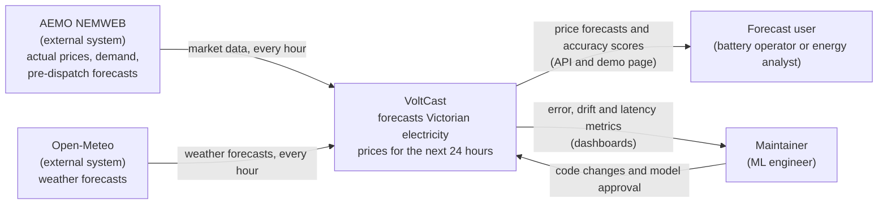

# VoltCast Architecture

This document holds the design diagrams. Each diagram answers one question.

## 1. System context

Question: what does VoltCast talk to, and who uses it?

Notes:

- VoltCast only reads from AEMO and Open-Meteo. It never writes to them.
- Both data sources are public and free, so the system needs no paid data licence.
- The forecast user and the maintainer see different outputs. The user sees forecasts. The maintainer sees system health.
