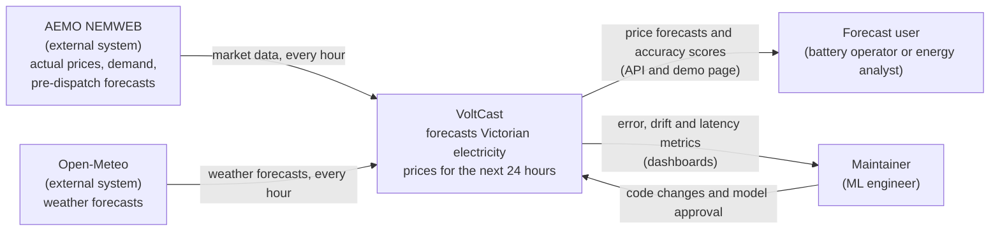
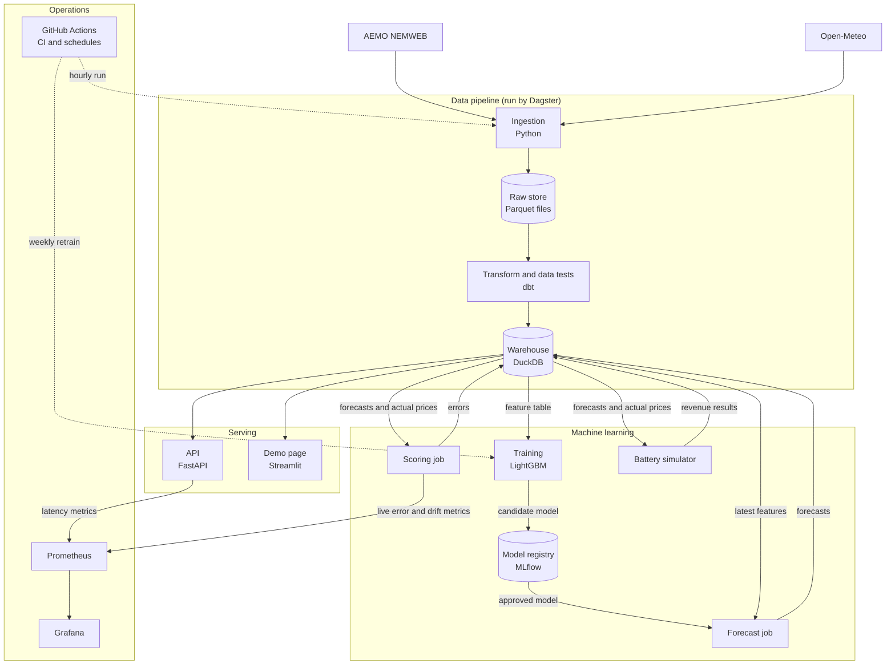
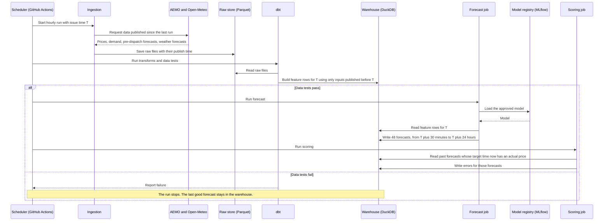
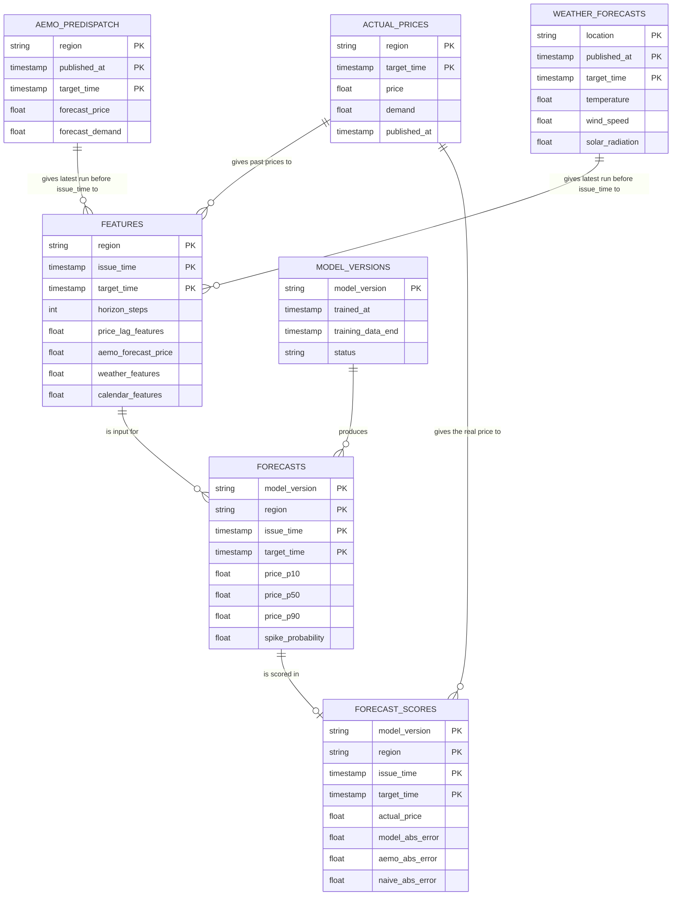

# VoltCast Architecture

This document holds the design diagrams. Each diagram answers one question.

## 1. System context

Question: what does VoltCast talk to, and who uses it?

Notes:

- VoltCast only reads from AEMO and Open-Meteo. It never writes to them.
- Both data sources are public and free, so the system needs no paid data licence.
- The forecast user and the maintainer see different outputs. The user sees forecasts. The maintainer sees system health.

## 2. Components

Question: what parts are inside VoltCast, and how does data move between them?

Notes:

- The warehouse is the centre. Every job reads from it and writes back to it, so jobs do not call each other directly.
- Raw files are kept unchanged. If a transform has a bug, we fix the dbt model and rebuild, without downloading again.
- Training and forecasting are separate jobs joined only by the model registry. A new model is used only after it is approved there.
- The API and the demo page only read. They never run the model during a request, so responses are fast.
- Solid lines show data. Dotted lines show triggers.

## 3. Hourly forecast run

Question: what happens, in order, during one hourly run?

In this diagram, T is the issue time. It is the moment the forecast is made.

Notes:

- Every raw file is saved with its publish time. This is what makes the rule "no future data" possible to check.
- Data tests run before the model. Bad input stops the run, so the model never produces a forecast from broken data.
- If a run fails, the API still serves the last good forecast. An old forecast is better than a wrong one.
- Scoring always looks backward. A forecast made at T can be fully scored only 24 hours later, when all 48 actual prices exist.

## 4. Data model

Question: what tables does the warehouse hold, and how do they join?

Three time columns appear in many tables:

- `published_at`: when the source made the value public.
- `issue_time`: when VoltCast makes a forecast.
- `target_time`: the end of the half hour that a value describes.

Notes:

- The two forecast source tables keep every run, not only the newest one. For one `target_time` there are many rows, one for each `published_at`.
- A feature row may use a source row only when `published_at` is earlier than `issue_time`. This join condition is the "no future data" rule written as SQL.
- One forecast row is one model, one issue time and one target time. So a single hourly run writes 48 rows.
- `FORECAST_SCORES` stores the model error beside both baseline errors for the same row, so every comparison uses exactly the same half hours.
- In `FEATURES`, the four columns ending in `_features` stand for groups of columns. The real names will be set in Sprint 2.
- Column names may change after the data check in step 0.7, when we see the real source files.
