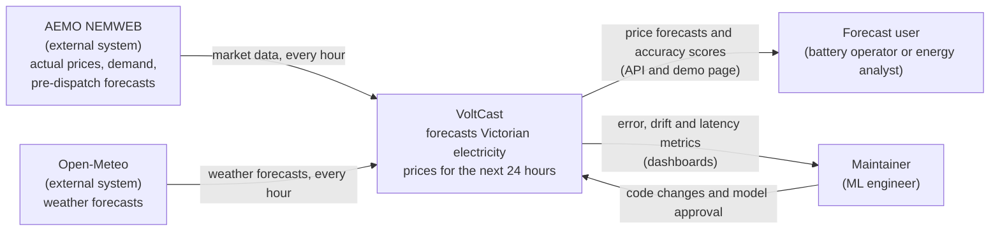
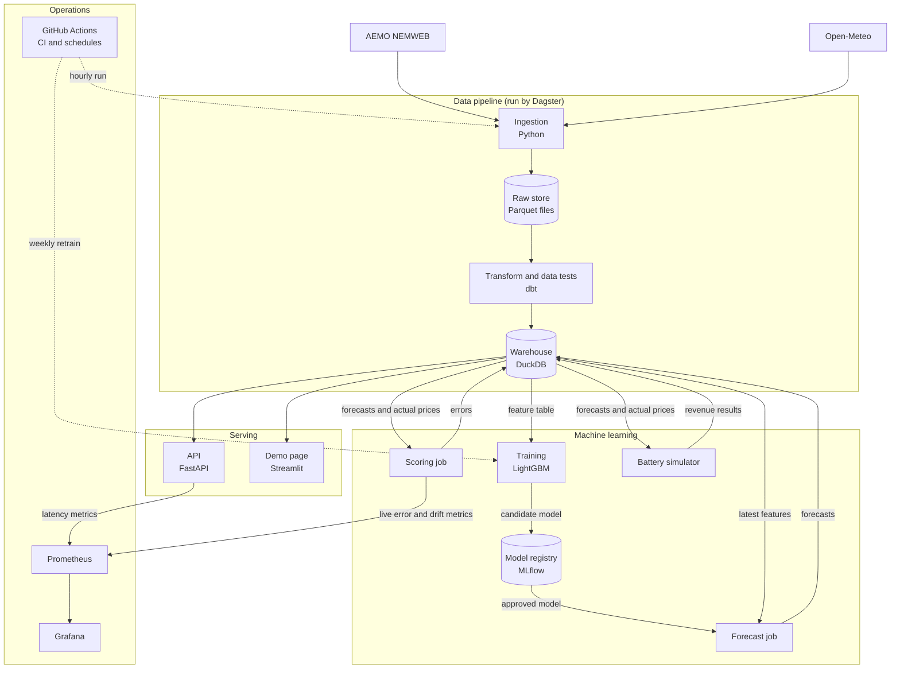

# VoltCast Architecture

This document holds the design diagrams. Each diagram answers one question.

## 1. System context

Question: what does VoltCast talk to, and who uses it?

Notes:

- VoltCast only reads from AEMO and Open-Meteo. It never writes to them.
- Both data sources are public and free, so the system needs no paid data licence.
- The forecast user and the maintainer see different outputs. The user sees forecasts. The maintainer sees system health.

## 2. Components

Question: what parts are inside VoltCast, and how does data move between them?

Notes:

- The warehouse is the centre. Every job reads from it and writes back to it, so jobs do not call each other directly.
- Raw files are kept unchanged. If a transform has a bug, we fix the dbt model and rebuild, without downloading again.
- Training and forecasting are separate jobs joined only by the model registry. A new model is used only after it is approved there.
- The API and the demo page only read. They never run the model during a request, so responses are fast.
- Solid lines show data. Dotted lines show triggers.
